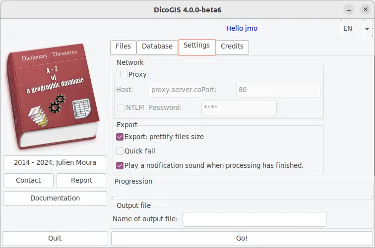

# Configuration

## Using graphical interface

Options are accessible through the `Settings` tab:

The output format is picked in the `Output file` group, under the tabs: an Excel workbook (`.xlsx` file), JSON files, or JSON files for uData (a folder of JSON files in both cases). Switching format adapts the output name accordingly.

Publishing previously exported metadata (JSON files) to a uData catalog is done
through the `Publish` tab: pick the folder containing the JSON files, fill in the
uData catalog connection (API URL, version, key, and optionally an organization ID),
then use the `Launch` button. After an export with the "JSON files for uData" format, the tab's folder is set to the exported one.

## Using environment variables

Some options and arguments can be set with environment variables. When a
GUI widget exists for one of them (see the `Settings` tab above), the
environment variable only sets its initial value: the widget can override it,
and the choice persists across runs in `options.ini`.

### Shared (CLI and GUI)

| Variable name                       | Corresponding CLI argument                       | Default value |
| :---------------------------------- | :----------------------------------------------: | :-----------: |
| `DICOGIS_DEBUG`                     | `--verbose`                                      | `false`       |
| `DICOGIS_ENABLE_NOTIFICATION_SOUND` | `--opt-notify-sound` / `--no-opt-notify-sound`   | `true`        |
| `DICOGIS_EXPORT_RAW_PATH`           | `--opt-raw-path`                                 | `false`       |
| `DICOGIS_EXPORT_SIZE_PRETTIFY`      | `--opt-prettify-size` / `--no-opt-prettify-size` | `false`       |
| `DICOGIS_LISTING_MAX_WORKERS`       | `--listing-max-workers`                          | unset (auto, based on CPU count) |
| `DICOGIS_LISTING_PARALLEL_SCAN`     | `--opt-parallel-scan` / `--no-opt-parallel-scan` | `false`       |
| `DICOGIS_OUTPUT_FORMAT`             | `--output-format` (`excel`, `json`, `udata` or `iso19139`) | `excel` |
| `DICOGIS_QUICK_FAIL`                | `--opt-quick-fail`                               | `false`       |

#### About the parallel folder scan

`DICOGIS_LISTING_PARALLEL_SCAN` scans the top-level subfolders of the target
folder in parallel worker threads instead of a single sequential walk. **It is
off by default, and enabling it is not always a win**: the per-file work is
mostly CPU-bound Python, so on local or otherwise fast storage the threads
mainly contend for the GIL and the scan gets *slower* (benchmarked at ~11x
slower on a local disk). It pays off on high-latency storage — typically a
network-mounted share — and the deeper the folder tree, the more it helps
(~5x faster on a 32-folder tree over a simulated 3 ms/`scandir()` link).

Rule of thumb: leave it off, and turn it on only when scanning a location you
know is slow to browse. `DICOGIS_LISTING_MAX_WORKERS` caps the number of worker
threads used when it's enabled (it is ignored otherwise); leave it unset to let
Python size the pool from the CPU count. In the GUI, the equivalent spinbox uses
`0` to mean "auto".

#### About the end of processing notification

At the end of a run, DicoGIS sends a system notification through [notify-py](https://github.com/ms7m/notify-py), with a sound unless `DICOGIS_ENABLE_NOTIFICATION_SOUND` (or the matching GUI checkbox) disables it.

- On Linux, the sound is played with `aplay`: install `alsa-utils` (e.g. `sudo apt install alsa-utils`) if it's missing. Without it, DicoGIS logs a warning and shows the notification without sound.
- When a notification fails, DicoGIS logs a warning but notify-py keeps the reason to itself: set the `notifypyEnableLogging` environment variable (e.g. to `1`) to have notify-py print its own trace to the console.

### GUI only

| Variable name      | Description                                                               | Default value |
| :----------------- | :------------------------------------------------------------------------ | :-----------: |
| `DICOGIS_UI_STYLE` | UI style. Can be any Qt style available on the running platform (e.g. `Fusion`, `Windows`) | unset (uses the Qt platform default) |
| `DICOGIS_QT_API` | Qt binding used by the GUI: `auto` uses `qgis.PyQt` when running inside QGIS and PyQt6 otherwise, `qgis` or `pyqt6` force one. Only useful for development and troubleshooting. | `auto` |

### CLI only — `inventory` subcommand

| Variable name                       | Corresponding CLI argument                       | Default value      |
| :---------------------------------- | :----------------------------------------------: | :----------------: |
| `DICOGIS_DEFAULT_LANGUAGE`          | `--language`                                     | `None`             |
| `DICOGIS_FORMATS_LIST`              | `--formats`                                      | `dxf,esri_shapefile,geojson,gml,kml,mapinfo_tab,sqlite,ecw,geotiff,jpeg` |
| `DICOGIS_OPEN_OUTPUT`               | `--opt-open-output` / `--no-opt-open-output`     | `true`             |
| `DICOGIS_OUTPUT_FILEPATH`           | `--output-path`                                  | `None`             |
| `DICOGIS_POSTGRES_SERVICES`         | `--pg-services`                                  | `None`             |
| `DICOGIS_START_FOLDER`              | `--input-folder`                                 | `None`             |

### ISO 19139 export

The first two are read by the CLI and the GUI, the last one is also an option of the `inventory` subcommand. Without a contact, `gmd:contact` only holds its role and a warning is logged. The location of the datasets stays out of the records unless asked for, since they are meant to be published.

| Variable name                       | Corresponding CLI argument    | Default value |
| :---------------------------------- | :---------------------------: | :-----------: |
| `DICOGIS_ISO_CONTACT_ORGANISATION`  |                               | `None`        |
| `DICOGIS_ISO_CONTACT_EMAIL`         |                               | `None`        |
| `DICOGIS_ISO_INCLUDE_ORIGINAL_PATH` | `--opt-include-original-path` | `false`       |

### Shared (CLI `publish` subcommand and GUI `Publish` tab)

These set the initial value of their `Publish` tab widget, same as the "Shared"
table above, except `DICOGIS_UDATA_API_KEY` and `DICOGIS_GEONETWORK_PASSWORD`: for
security, the API key and the password typed into the GUI are never written to
`options.ini`, so they must be re-entered (or re-exposed through the environment
variable) on every run.

| Variable name                    | Corresponding CLI argument    | Default value                    |
| :------------------------------- | :---------------------------: | :------------------------------: |
| `DICOGIS_PUBLISH_INPUT_FOLDER`   | `--input-folder`              | `None`                           |
| `DICOGIS_UDATA_API_KEY`          | `--udata-api-key`             | `None`                           |
| `DICOGIS_UDATA_API_URL_BASE`     | `--udata-api-url-base`        | `https://demo.data.gouv.fr/api/` |
| `DICOGIS_UDATA_API_VERSION`      | `--udata-api-version`         | `1`                              |
| `DICOGIS_UDATA_ORGANIZATION_ID`  | `--udata-organization-id`     | `None`                           |
| `DICOGIS_PUBLISH_TARGET`         | `--target` (`udata` or `geonetwork`) | `udata`                   |
| `DICOGIS_PUBLISH_TIMEOUT`        | `--timeout`                   | `30` (seconds)                   |
| `DICOGIS_GEONETWORK_URL_BASE`    | `--geonetwork-url-base`       | `None` (e.g. `https://catalogue.example/geonetwork`) |
| `DICOGIS_GEONETWORK_PORTAL`      | `--geonetwork-portal`         | `srv`                            |
| `DICOGIS_GEONETWORK_USERNAME`    | `--geonetwork-username`       | `None`                           |
| `DICOGIS_GEONETWORK_PASSWORD`    | `--geonetwork-password`       | `None`                           |
| `DICOGIS_GEONETWORK_GROUP`       | `--geonetwork-group`          | `None` (mandatory, numeric)      |
| `DICOGIS_GEONETWORK_CATEGORIES`  | `--geonetwork-categories`     | `None` (identifiers, comma separated) |
| `DICOGIS_GEONETWORK_UPDATE_MODE` | `--geonetwork-update-mode` (`overwrite` or `complete`) | `overwrite` |
| `DICOGIS_GEONETWORK_PUBLISH_TO_ALL` | `--geonetwork-publish-to-all` | `false`                       |
| `DICOGIS_GEONETWORK_REJECT_IF_INVALID` | `--geonetwork-reject-if-invalid` | `false`                 |
| `DICOGIS_GEONETWORK_AUTHCFG`     |                               | `None` (QGIS only, replaces the username and the password) |
| `DICOGIS_HTTP_BACKEND`           |                               | `auto`: the network stack of QGIS when running inside QGIS, `requests` otherwise. `requests` or `qgis` force one: only useful for development and troubleshooting. |

See [Publishing to GeoNetwork](./publish_geonetwork.md).
